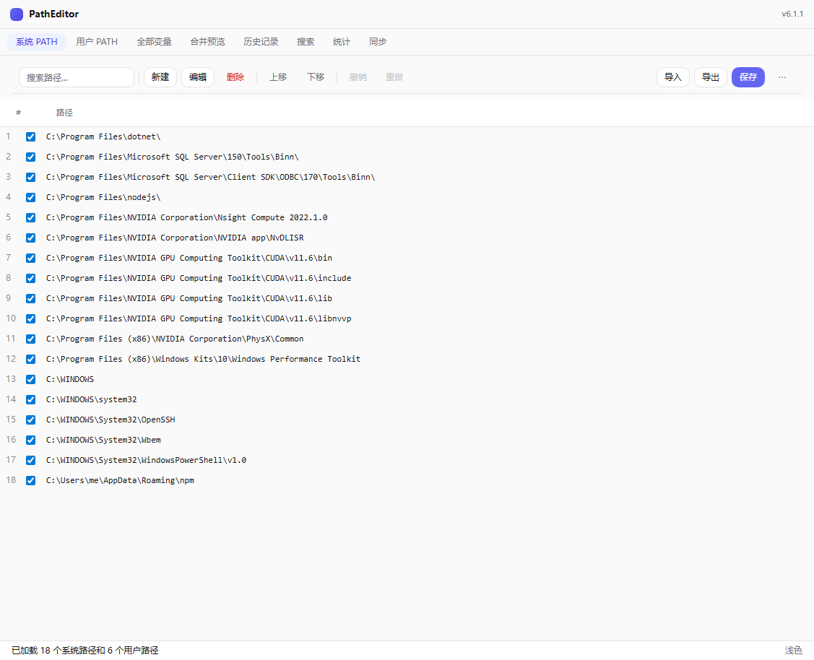
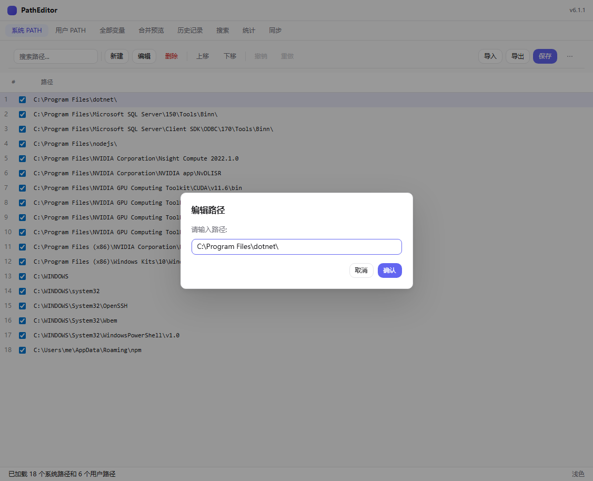
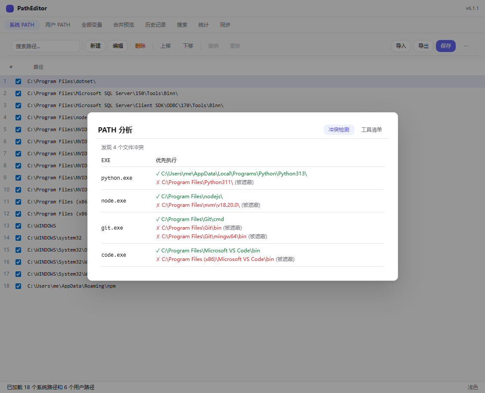
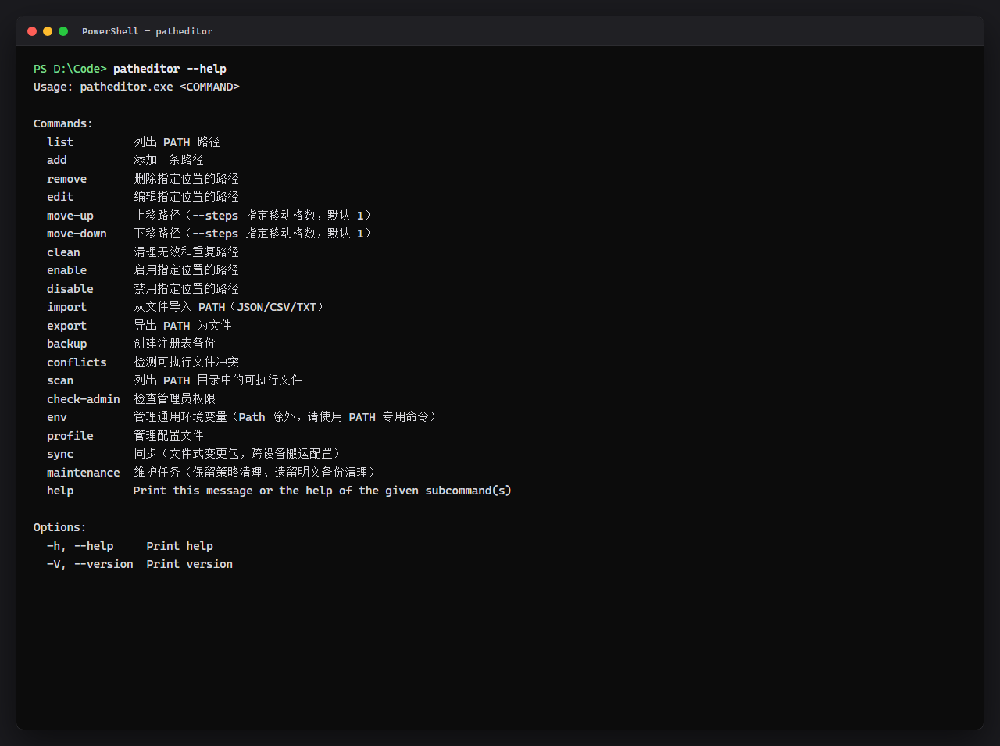
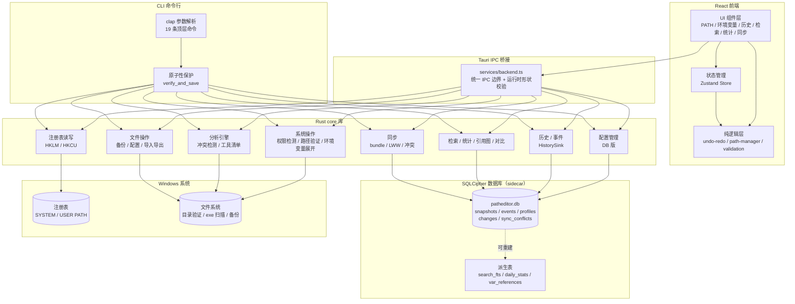
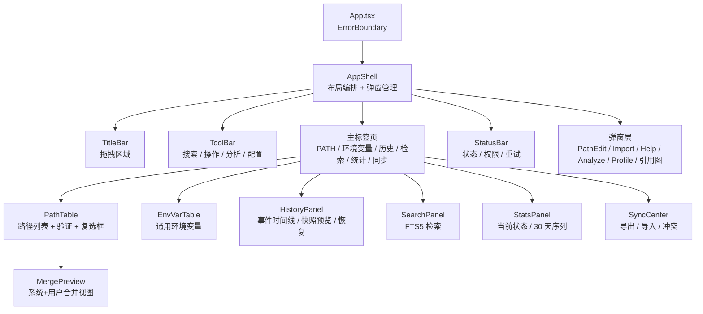
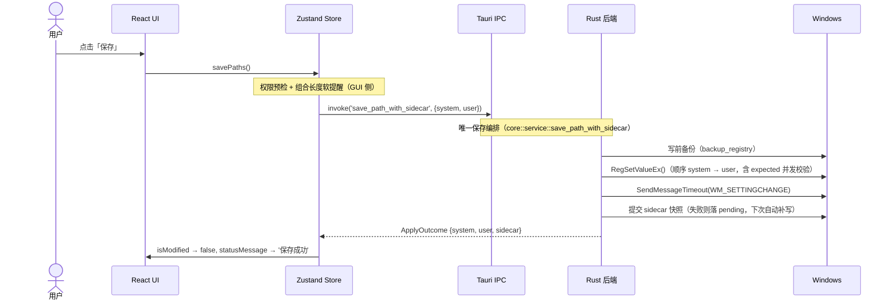
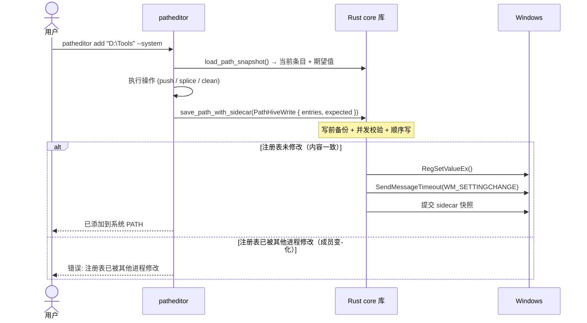

<p align="center">
  <h1>PathEditor</h1>
  <p>Windows 系统环境变量 (PATH) 编辑器</p>
</p>

<p align="center">
  
  
  
  
  
  
  
  <a href="https://codecov.io/gh/LHY0125/PathEditor"></a>
  
</p>

---

## 截图

### 主界面



### 路径编辑



### 冲突检测



### CLI 命令行



---

## 简介

PathEditor 是 Windows PATH 环境变量的可视化管理工具。支持系统变量和用户变量的增删改查、拖拽排序、一键清理无效路径、导入导出以及完整的撤销/重做。

v6.1.0 使用 **Tauri 2.x + React 19 + TypeScript + Rust**，并新增 **SQLCipher 加密数据库**：历史时间线、配置版本、备份索引、全文检索、统计、引用图与文件式跨设备同步。**注册表仍是唯一真相源**；数据库不可用时应用照常编辑，只把历史/检索/同步降级。

## 架构



### 组件树



### 操作流程



### CLI 操作流程



## CLI 命令行

### 安装

```powershell
scoop bucket add lhy https://github.com/LHY0125/scoop-bucket
scoop install lhy/patheditor-cli
```

或从源码安装：

```bash
cargo install --path cli
```

```bash
# 安装后可直接使用:
patheditor --help

# 查看 PATH
patheditor list --system --json

# 冲突检测
patheditor conflicts

# 配置切换
patheditor profile save "Python开发"
patheditor profile apply "Python开发"

# 通用环境变量（Path 除外）
patheditor env list     [--system|--user] [--json]
patheditor env get      <NAME> [--system]
patheditor env set      <NAME> [--value <V>|--stdin|--value-file <F>] (--revision <R>|--force) [--dry-run] [--json]
patheditor env add      <NAME> [<VALUE>] [--kind string|expand] [--system] [--dry-run] [--json]
patheditor env remove   <NAME> (--revision <R>|--force) [--dry-run] [--json]
patheditor env backup   [--json]
patheditor env backups  [--json]
patheditor env restore  <FILE> [--dry-run] [--force] [--json]

# 跨设备同步（口令交互输入，不会落盘）
patheditor sync export <FILE>
patheditor sync import <FILE>
patheditor sync status
patheditor sync conflicts [--all]
patheditor sync resolve <ID> --take local|remote

# 维护任务（保留策略 / 遗留明文备份）
patheditor maintenance prune                    [--dry-run]
patheditor maintenance cleanup-legacy-backups   [--dry-run] [--yes]
```

`remove`、`edit`、`move-up`、`move-down` 默认操作用户 PATH，传入 `--system` 才操作系统 PATH。CLI 的 `list`、`import/export`、`profile`、`enable/disable` 都使用完整快照，避免丢失 `enabled=false` 条目和顺序。

`env` 子命令管理通用环境变量（`Path` 除外，请用 PATH 专用命令）。默认操作用户 hive，加 `--system` 操作系统 hive。

`set` 与 `remove` 必须显式选择并发模式：`--revision <R>`（取自 `env list --json`，外部修改时拒绝写入，退出码 3）或 `--force`（跳过 revision 校验直接覆盖，最后写入者胜，仍受保护名单/类型/权限约束）。敏感值建议用 `--stdin` 或 `--value-file` 传入，避免明文进入 shell 历史与进程列表。

`set` / `add` / `remove` 支持 `--dry-run`：只显示将要发生的变更，**不写注册表、不产生备份、不广播**。预览不要求 `--revision` / `--force`；变量不存在时照常报错（与真正执行时的判定一致）。加 `--json` 可输出脚本友好的摘要（需与 `--dry-run` 同用，单独用会以退出码 2 被拒绝）：

```bash
patheditor env set JAVA_HOME --value "C:\Java\jdk-21" --dry-run --json
# {"operation":"set","hive":"user","name":"JAVA_HOME","oldValue":"C:\\Java\\jdk-17","newValue":"C:\\Java\\jdk-21","kind":"string","writable":true,"sensitive":false}
```

命中敏感规则的变量（如 `*_TOKEN` / `*_KEY`）在预览里不回传明文：`oldValue` / `newValue` 为 `null`、`sensitive` 为 `true`，文本预览显示 `(敏感)`。这与 `env list` 的打码一致 —— 预览不新开明文出口。

CLI 退出码约定：`0` 成功、`1` 一般错误、`2` clap 参数解析失败、`3` revision 冲突（仅 `env set` / `env remove` 且使用 `--revision` 时；PATH 命令恒为 `1`）、`4` 同步合并冲突（需人工解决）、`5` 密钥/DPAPI。`--force` 不携带 revision，不会因并发冲突产生退出码 3；同步包格式/口令/篡改 → `1`（重试无用）。

完整 19 条顶层命令（另有 `env` / `profile` / `sync` / `maintenance` 子命令组）：`patheditor --help`

### 环境变量备份与恢复

```bash
# 立即备份两个 hive 的全部环境变量
patheditor env backup

# 查看已有备份（按时间倒序；只列文件，不解析内容）
patheditor env backups

# 先看差异，不写注册表
patheditor env restore ~/.patheditor/backups/env_backup_20260921_200437_062.pebak --dry-run

# 执行恢复（默认模式：任一变量被外部改动则整批中止，退出码 3）
patheditor env restore ~/.patheditor/backups/env_backup_20260921_200437_062.pebak
```

此外，**每一次环境变量写入前都会自动备份**：CLI 的 `env set` / `env add` / `env remove` 与 GUI 的编辑 / 新建 / 删除都会先落一份备份，备份失败**不阻断写入**，只在 stderr 或状态栏提示。默认保留最近 20 份（可在 `~/.patheditor/config.ini` 用 `env_backup_keep = N` 覆盖），轮换只删除本工具生成的 `env_backup_*.pebak` / `.json`。

**新备份默认是 DPAPI 加密的 `.pebak`**；只有拿不到密钥时才回落明文 `.json` 并打印警告。`.pebak` 与当前 Windows 用户绑定，换用户/换机器后无法解密。遗留的 `env_backup_*.json` 仍可一次性恢复。

> ⚠️ **遗留/回落的 `env_backup_*.json` 含环境变量明文**（API key、token 等）。请勿同步到云端或提交到版本库。确认不再需要后，用 `patheditor maintenance cleanup-legacy-backups --dry-run` 预览，再加 `--yes` 转为 `.pebak` 并删除明文。

`env restore --dry-run` 的「修改 N」恒显示 0 —— 备份的 revision 与注册表不一致时一律判为「冲突」而非「修改」，两者在实现中是同一个条件。`--force` 下被冲突覆盖的变量会被改写却计入「冲突」，所以 dry-run 会**低报** force 模式的实际改动量。另需注意：**未提权时恢复恒失败**（无法以写权限打开系统 hive），请以管理员身份运行。

## 功能

### 路径管理

- 查看和编辑 **系统 PATH**（HKLM）和 **用户 PATH**（HKCU）
- 新建、编辑、删除、上移、下移路径条目
- 多选批量删除
- 实时搜索过滤
- 合并预览（系统 + 用户路径并列显示）
- 文件夹拖拽添加

### 全环境变量管理

- 查看和管理系统 / 用户环境变量项下的**所有变量**（不止 PATH）
- 显示变量的真实注册表类型（`REG_SZ` / `REG_EXPAND_SZ`），不支持的类型只读展示
- 敏感变量（名称含 TOKEN / KEY / SECRET / 密码 / API）默认打码，需显式点击才显示明文
- 系统内置关键变量（`windir`、`ComSpec`、`PATHEXT` 等）硬锁定为只读，防止改坏系统
- `Path` 仍由专用 PATH 视图管理，保证启用/禁用状态与顺序不被绕过

### 路径验证

- **红色**标记：路径在文件系统中不存在
- **橙色**标记：路径在列表中重复出现
- 环境变量路径（含 `%VAR%`）悬浮展开预览

### 撤销/重做

- 支持 9 种操作类型，最多 50 步历史
- 新增、删除、编辑、移动、清理、清空、导入均可撤销

### 历史记录（v6 M1）

- PATH 快照与操作事件持久化到 **SQLCipher 加密数据库**（`~/.patheditor/patheditor.db`）
- 「历史记录」标签页按时间倒序浏览事件
- **敏感变量的值默认掩码**（`••••`），掩码在 Rust 侧完成 —— 前端从不接收未要求的明文
- **数据库是 sidecar，注册表仍是唯一真相源**：DB 打不开时 GUI 照常工作，只把历史/检索/统计/同步降级，
  并在窗口顶部显示常驻降级条幅

> **事件与快照已接通**：每条事件都指向「操作前」快照，点击可展开详情并恢复。

### 检索与统计（v6 M2）

- **全文检索**（FTS5）：索引 PATH 条目串、环境变量名、配置名/描述/标签。
  **绝不索引环境变量的值** —— 明文只存在于加密库里，不进任何派生表。
  命中处由 Rust 侧产出高亮片段，前端只渲染，不重新匹配。
- **统计仪表盘**：「当前状态」（条目数 / 平均长度）与「最近 30 天」历史序列**分两块显示**——
  某一天的条目数是「那天最后一次保存时」的值，不是「现在」，混在一起会误导。
  另有最常改变的变量与配置应用次数。
- **快照对比**：任选两条历史事件对比，**系统与用户 PATH 分开**呈现新增 / 删除 / 移动 / 启用状态变化。
  ⚠️ 环境变量对比**尚未提供**（本版本未纳入范围），界面上会显式说明，而不是让你以为「env 没变化」。
- **引用图**：解析 `%VAR%` 引用关系，展示「谁引用了它」（删除前的影响范围）、
  「它依赖了谁」（递归）与循环引用。
- **冲突历史**：每次路径扫描持久化，支持两次扫描的差异对比与「首次 / 最近出现」。

> **派生数据可随时重建**：搜索索引、统计与引用图都不是真相源，启动时会按需重建；
> 数据库损坏或异常退出后这些数据会自动恢复。
>
> **已知限制**：CLI 不重建派生表 —— 用 CLI 改过 PATH 后，GUI 的引用图与统计可能仍是旧值，
> 重启 GUI 后对齐（未排期修复）。

### 跨设备同步（v6）

- **同步中心**：导出 / 导入加密同步包，查看待导出变更数与冲突列表。
- **同步包**：`Argon2id`（64 MiB / t=3 / p=1）派生密钥 + `ChaCha20-Poly1305` 加密，
  AAD 覆盖包头，**改一个字节都打不开**。口令不落盘、不进 shell 历史，CLI 用隐藏输入。
- **合并规则**：LWW（`lamport` 高者胜；相同时按 `device_id` 破平）。
  `snapshot` / `profile` 按**整实体**比较（墓碑与内容变更共用一条时间线），
  其余实体仍按字段比较。
  真正的平局（同 lamport、不同设备、值不同）**不会被静默覆盖**——记一条冲突，由你选。
- **配置同步**：`profile` / `profile_revision` 会随包落库；与本地同名的配置自动改名为
  「原名 (来自 设备)」，导入提示会显示改名数量。删除的配置以**墓碑**同步（软删除）。
- **CLI**：`patheditor sync export|import|status|conflicts|resolve`。
  退出码：合并冲突 → 4（需人工解决），包格式/口令错误 → 1（重试无用）。

> **⚠️ 同步不写注册表。** 导入只更新本机数据库；要让配置真正生效，必须再执行
> `profile apply` 或对应的 PATH 命令。这是刻意的：同步是「把配置搬过来」，
> 不是「替我改系统」。
>
> **已知限制**：配置合并是**整实体 LWW**，不是字段级——两台设备同时改同一个配置的
> 不同字段时会互相覆盖。同步范围不含 `events`（本机操作日志）与备份索引。
>
> **同步包是增量包**：导出只包含「尚未导出的变更」。新设备需要**从第一份包开始按顺序应用**；
> 只拿到后续包时，配置引用的快照不在本地，整包会被拒绝（`SyncFormat`，退出码 1）。

> **密钥与备份**：数据库密钥由 Windows DPAPI 保护，存放在 `~/.patheditor/keys/db.key.dpapi`，
> 文件权限限定为当前用户 + SYSTEM。
> **该密钥与当前 Windows 用户绑定**，换用户或换机器后历史无法解密；PathEditor 不会静默重建空库。
> 环境变量备份从本版起写 `.pebak`（DPAPI 加密），`env backups` 会带 `encrypted` 标志。
> 遗留的 `env_backup_*.json` 仍可一次性恢复，**读取时会在 stderr 打印明文警告**（GUI 记入日志）。
> **降级回落**：若密钥文件不可用（拿不到 DPAPI 密钥），备份会回落到明文 `.json` 并**在 stderr 打印警告**——
> 这是为了让备份功能在密钥故障时依然可用，但意味着此时磁盘上会新增明文敏感文件。
>
> **环境变量的 N 路对比尚未提供**（本版本未纳入范围），环境变量对比面板会显式说明这一点。

### 维护任务（v6 M4）

- **保留策略**：GUI 每次启动自动清理「已导出超过 90 天」的 `changes` 与「已解决超过 30 天」的
  `sync_conflicts`；**待导出队列（`exported_at IS NULL`）永不删除**。CLI：
  `patheditor maintenance prune [--dry-run]`。
- **遗留明文备份清理**：把 `env_backup_*.json` 先转成 DPAPI 加密的 `.pebak` 并**回读校验**，
  成功后才删除明文；任一失败保留原文件。必须显式 `--yes`。

### 导入/导出

- **JSON**：结构化导出，含版本和时间戳
- **CSV**：UTF-8 BOM 编码，兼容 Excel
- **TXT**：纯文本，每行一个路径

### 安全

- 保存前自动备份注册表到 `~/.patheditor/backups/`（文件名含时间戳，如 `path_backup_20260921_200437_062.txt`）；同类备份默认保留最近 20 份，可在 `~/.patheditor/config.ini` 用 `path_backup_keep = N` 覆盖。轮换只删除本工具生成的 `path_backup_*.txt`，且**仅在默认备份目录生效**（用户指定目录不轮换）
- **CLI 的 `add` / `remove` / `edit` / `move-up` / `move-down` / `clean` / `enable` / `disable` / `import` / `profile apply` 每次成功写入 PATH 前也自动产生一份 `path_backup_*.txt`**（与 GUI 保存、与 `env` 侧写入前备份对称）
- 环境变量写入前自动备份到同一目录（默认 `.pebak`，DPAPI 加密；密钥不可用时回落明文 `.json`），支持差异预览与一键恢复；遗留/回落的 `.json` 含敏感值明文，请勿同步到云端或提交到版本库
- PATH 长度检查（Windows 单变量上限 32767 字符）
- 非管理员仅系统 PATH 只读，用户 PATH 仍可编辑
- 保存中途失败精确提示哪个注册表 hive 出错
- 禁用路径从注册表移除后仍会以完整快照保留，重启后可恢复显示并重新启用
- 未保存修改时的退出确认使用 Tauri 异步对话框，绝不阻塞界面线程

### 界面

- 深色模式 / 浅色模式
- 中文 / English 界面切换
- 全局键盘快捷键
- 修改状态指示（黄点）+ 未保存退出确认

## 安装

> 本仓库不维护 scoop manifest；两个应用分别在 `LHY0125/scoop-bucket` 中发布。

### 图形界面（GUI）

**方式一：安装包**

从 [Releases](https://github.com/LHY0125/PathEditor/releases) 下载最新版 `PathEditor_6.1.0_x64-setup.exe` 安装。

**方式二：Scoop（免安装）**

```powershell
scoop bucket add lhy https://github.com/LHY0125/scoop-bucket
scoop install lhy/patheditor-gui
```

从 portable zip 解压即用（`PathEditor.exe` + `WebView2Loader.dll`），开始菜单生成 PathEditor 快捷方式。

**方式三：源码构建**

```bash
# 安装依赖
npm install

# 构建安装包
npx tauri build
```

### 命令行（CLI）

**方式一：Scoop**

```powershell
scoop bucket add lhy https://github.com/LHY0125/scoop-bucket
scoop install lhy/patheditor-cli
```

安装后即可在任意终端使用 `patheditor`（CLI 二进制在发布时重命名为 `patheditor-cli_<版本>_x64.exe`，manifest 用 `#/patheditor.exe` 装回原名）。

**方式二：从源码安装**

```bash
cargo install --path cli
```

> **要求**：Windows 10+（自带 WebView2），管理员权限才能编辑系统 PATH。

## 开发

```bash
# 开发模式 GUI（热更新）
npx tauri dev

# 仅前端
npm run dev

# 前端测试
npm test

# Rust workspace 检查
cargo check

# CLI 构建
cargo build --release -p patheditor-cli

# 完整构建
npx tauri build
```

### 技术栈

| 层        | 技术                                      |
| --------- | ----------------------------------------- |
| 前端框架  | React 19 + TypeScript (strict)            |
| UI 样式   | Tailwind CSS 4                            |
| 状态管理  | Zustand                                   |
| 国际化    | i18next                                   |
| 桌面框架  | Tauri 2.x                                 |
| 核心库    | Rust workspace (core + gui + cli)         |
| 数据库    | SQLCipher（rusqlite + bundled OpenSSL）   |
| 同步加密  | Argon2id + ChaCha20-Poly1305              |
| 检索      | SQLite FTS5                               |
| 前端测试  | Vitest (33 files / 398) + Playwright (54) |
| Rust 测试 | cargo test (322 passed / 2 ignored)       |
| 构建      | Vite + Cargo                              |
| 打包      | NSIS                                      |

### 项目结构

```
src/                          # 全部源码
├── core/                     # Rust 核心库（零 Tauri 依赖）
│   ├── db/                   # v6 SQLCipher 数据层
│   │   ├── schema.rs / crypto.rs / dpapi.rs / dacl.rs
│   │   ├── history.rs / history_sink.rs / profiles.rs / backups.rs
│   │   ├── search.rs / stats.rs / refs.rs / compare.rs / scan_history.rs
│   │   ├── maintenance.rs
│   │   └── sync/             # bundle / change_log / merge / conflict / export / import
│   ├── error.rs              # CoreError 结构化错误（code 驱动错误码与前端本地化）
│   ├── service.rs            # 应用服务层（多 hive 事务编排 + 侧车快照）
│   ├── persist.rs            # 持久化原语（schemaVersion / .bak 轮换 / 损坏隔离）
│   ├── registry/             # 注册表通路（path / access / env_var / conflict / store）
│   ├── system.rs             # 权限检测、路径验证、环境变量展开
│   ├── scanner.rs            # 冲突检测、工具清单
│   ├── backup.rs / disabled.rs # 备份（.pebak）、禁用状态
│   └── fs.rs                 # 文件读写、导入导出解析
├── cli/                      # 命令行工具（bin 产物 patheditor.exe）
│   └── src/                  # cli / path_ops / runtime / env_ops / import_export /
│                             #   profile_ops / scan_ops / sync_ops / maintenance_ops
└── gui/
    ├── src-tauri/            # Tauri 桌面应用（bin 产物 PathEditor.exe）
    │   └── src/commands/     # 薄包装 → 调用 core
    └── web/                  # React 前端
        ├── src/core/         # 纯逻辑 — 零框架依赖
        ├── src/store/        # Zustand：app / env / history / search / sync / theme
        ├── src/services/     # backend IPC + path session
        ├── src/components/   # layout / path-list / env-list / toolbar / dialogs /
        │                     #   history / search / stats / sync / ui
        ├── src/hooks/        # useAppActions、useKeyboard、usePathValidation
        ├── src/i18n/         # zh-CN / en
        ├── src/config/       # default.json
        ├── tests/unit/       # 前端单元测试
        └── e2e/tests/        # Playwright E2E（mock IPC）
docs/dev/                     # 开发细节（架构/存储/接口/安全/测试/发布，按需读取）
docs/审核和开发/                # 审查与开发记录
```

## 快捷键

| 快捷键   | 功能     |
| -------- | -------- |
| `Ctrl+N` | 新建路径 |
| `Ctrl+S` | 保存     |
| `Ctrl+Z` | 撤销     |
| `Ctrl+Y` | 重做     |
| `Ctrl+F` | 搜索     |
| `Delete` | 删除选中 |
| `F1`     | 帮助     |

## 贡献

欢迎提交 Issue 和 Pull Request。在开始大改动前，建议先开 Issue 讨论。

### 本地开发环境

- Node.js 20+（CI 使用 Node 20）
- Rust 1.95+；本地开发用 `stable-x86_64-pc-windows-gnu`，CI/发布用 MSVC
- MinGW-w64（GNU 下测试需要 `windres`；MSVC 下由链接器清单处理）
- 首次全量构建需要 `make`、`perl`（MSVC 下还需 NASM），约 45 分钟

### 代码规范

- TypeScript `strict: true`，零编译错误
- 所有 Rust `unsafe` 块必须有 `// SAFETY:` 注释
- 前端核心逻辑在 `src/gui/web/src/core/`，纯函数，零依赖，可独立测试

## 许可证

MIT License

## 作者

[刘航宇](https://github.com/LHY0125) — 河南理工大学人工智能协会
